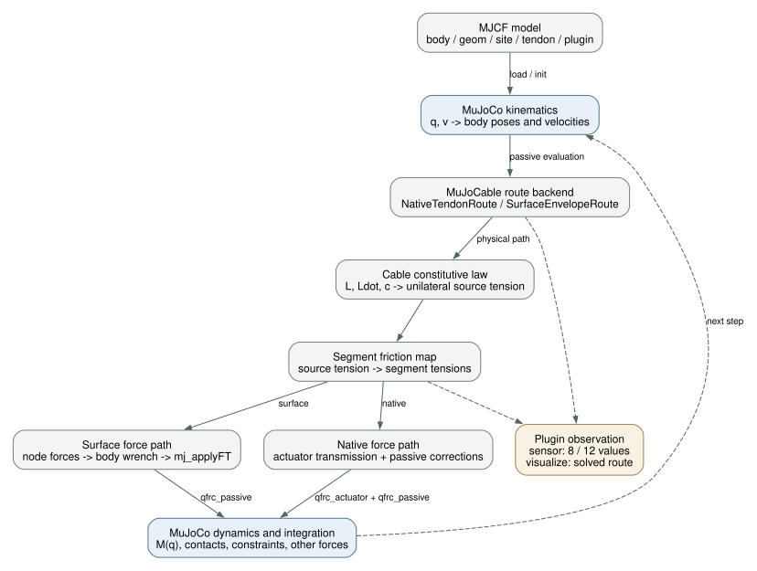

# MuJoCo Interfaces and Architecture

## The Technical Boundary

| MuJoCo core | MuJoCable plugin |
|---|---|
| MJCF compilation, bodies/joints, mass/inertia | Read compiled sites, geoms and meshes |
| Rigid-body collision, friction contact, equalities and constraints | Cable centerline routes over configured obstacles |
| Kinematics and integration | Unilateral axial law, take-up state and segment transmission |
| `mjData`, GUI and scene | Instance state, sensors and visualization callbacks |

Cable forces affect rigid-body contact outcomes, but these are not the same contact solver. `geom friction` is not automatically a cable coefficient, and a route hint is not a MuJoCo contact point.

## Callbacks and Data Flow

| Interface | Responsibility | Common failure |
|---|---|---|
| Register `mujoco.cable.unilateral` | Declare actuator/passive/sensor capabilities and config keys | Loading new XML with an old library |
| init / Create | Validate names, roles, surfaces and instances | Hint/geom mismatch, invalid mesh, nonzero surface gear |
| Passive compute | Surface route, law, segment forces and `qfrc_passive` accumulation | Ignoring invalid routes and disabled forces |
| Actuator compute | Native force output; surface primarily reports `-T` | Treating zero surface transmission gear as no actuation |
| Advance | Integrate/filter contraction and update state | Misreading rate estimates or reusing stale state |
| Sensor compute | Eight native or twelve surface values | Treating source tension as every segment's tension |
| Visualize | Draw the solved route in the scene | Mistaking the seed polyline for the solved route |
| Reset / copy | Manage scalar state, corridors and caches | Old state layouts or shared mutable route state |

Python overlays are not required to display the surface route. The project viewer adds labels, debug markers and auxiliary native-path displays.

## C++ Components

- `UnilateralCable`: configuration, constitutive law, control state, friction, forces and callback entry points.
- `NativeTendonRoute`: MuJoCo-computed native tendon path information.
- `SurfaceEnvelopeRoute`: cylinder/mesh routes, contact points, directions, status and residuals.

These are implementation components, not a promised stable external SDK ABI. Users primarily configure MJCF and use MuJoCo's C/Python APIs.

## Native and Surface Force Paths

Native actuator output `-T` maps through the MuJoCo tendon transmission, with any plugin corrections added separately. Surface routing differs from the native seed, so runtime nodes define the complete body-force map. Its actuator transmission gear must be zero to avoid duplicate loading.

## Standalone Plugin versus Core Extension

Default explicit routing, force propagation, sensors and visualization work as a standalone dynamic library. The CPU plugin is stateful and iterative; placing it in a plugin directory does not make it compatible with MJX/Warp/GPU execution.

`implicit_compliant` depends on additional host interfaces such as `mjpPluginImplicit` and corresponding compile conditions. Do not advertise it as enabled in an unmodified MuJoCo 3.4.0 host. Releases and experiments should distinguish standalone capabilities from extensions requiring core changes.

For the general plugin API, consult the [MuJoCo Extensions documentation](https://mujoco.readthedocs.io/en/stable/programming/extension.html). This manual describes MuJoCable, not a replacement for the official MuJoCo API reference.
