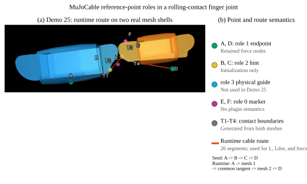

# Routing, Reference Points and Meshes

## Hints Select a Branch

During initialization, each role-2 hint is projected onto its corresponding surface to select cylinder winding or a mesh seed face and corridor. It is not a fixed physical node afterwards. Entry and exit points move with the geometry. To change the initialized wrapping side, edit the hint and **reload/reinitialize the model**.



These colors are a teaching convention, not reserved physical meanings: endpoints are green, hints yellow, guides cyan and ordinary markers magenta; the solved route and tangent points are drawn separately. Projects may choose their own `rgba`.

## Place Sites in SolidWorks for Complex CAD

For fingers and multi-body mechanisms, use the [SOLIDWORKS Reference Geometry Exporter](https://github.com/MuJoCable/solidworks-reference-geometry-exporter) to define landmarks in CAD and transfer them into MJCF.

1. Create named reference points or 3D sketch points for attachments, eyelets and wrapping hints.
2. Open the assembly in Windows SolidWorks and set components to **Fully Resolved**. Follow the [macro installation](https://github.com/MuJoCable/solidworks-reference-geometry-exporter#installation), import `ExportAssemblyReferenceGeometry.bas`, and run `ExportAssemblyReferenceGeometry.main` to export CSV.
3. Use the [MJCF converter](https://github.com/MuJoCable/solidworks-reference-geometry-exporter/blob/main/docs/MJCF_CONVERTER.md) to bind selected records to bodies and assign `user=1/2/3`.
4. Check at least three known points in the viewer before connecting the seed tendon.

Start with the bundled converter example, running these commands in its repository:

```bash
git clone https://github.com/MuJoCable/solidworks-reference-geometry-exporter.git
cd solidworks-reference-geometry-exporter
python -m pip install -r requirements.txt
python tools/sw_reference_to_mjcf.py \
  --csv examples/example_output.csv \
  --mjcf examples/minimal_model.xml \
  --mapping examples/mapping.json \
  --output generated/bound_model.xml \
  --report generated/binding_report.json
```

Then substitute your CSV, MJCF and mapping paths. For a MuJoCable input model, add `--plugin "$CABLE_PLUGIN_LIBRARY"`. Write the output beside the input XML to retain relative mesh paths.

Match assembly coordinates to assembly-level STL, and part-local coordinates to individually exported parts. CSV includes meters and millimeters; MJCF positions use meters. Create explicit CAD landmarks for holes that are not already marked: the exporter does not infer every hole position.

## Choose a Route Backend

| Mode | Application | Boundary |
|---|---|---|
| `native` | Fixed sites, natively supported sphere/cylinder wraps, tensegrity | Sites retain native path-point semantics; no initialization-only hints |
| `surface` with cylinders | One or several cylindrical sheaves | Cylinder lateral surface; not a general end-cap wrapping solver |
| `convex_surface` | Closed convex meshes | Start with clean low-/medium-resolution geometry |
| `taut_obstacle` | Closed nonconvex obstacles | A taut nonpenetrating path can bridge recesses rather than adhere inside them |
| `guided_surface` | Known support corridors, rolling joints or extruded profiles | The guide assumption must match the mechanism; no arbitrary global-shortest-path guarantee |

## Route over Two Surfaces

```xml
<config key="route_mode" value="surface"/>
<config key="mesh_route_mode" value="taut_obstacle"/>
<config key="route_tendon" value="seed"/>
<config key="wrap_geoms" value="proximal_route distal_route"/>
```

Seed order is `endpoint -> proximal_hint -> distal_hint -> endpoint`. A shared exit/entry solution should define the free span between surfaces; a straight projection through two hints is not a common tangent.

At zero or near-zero clearance, the free-span direction becomes degenerate. `composite_merge_distance` controls the composite-contact distance treatment; it does not permit cable penetration or solid-body overlap. Diagnose initial interference with a small inspectable gap before approaching true contact.

## Why Does the Cable Take the Side Face?

An extruded STL has front/back caps as well as its curved side. Hints near an edge may initialize an unintended corridor. Check:

1. Consistent scale and body coordinates for sites and meshes.
2. Endpoints outside the solid and on the intended thickness side.
3. Hints near the intended curved support surface, not closer to an end cap.
4. Whether endpoints and hints should be on the thickness mid-plane, with `mesh_guide_axis` specifying that plane's normal.

For ICRA letters extruded along y, `y=0` is the thickness center and `mesh_guide_axis="0 1 0"` selects its normal. This is not a forward travel direction. Do not hide incorrect coordinates with a large guide weight; inspect residuals, branch selection and forces as well.

## Are All Geoms Cable Obstacles?

No. The plugin checks the configured wrap surfaces, not every geom in the scene. Free spans between bodies must also be checked against relevant configured obstacles. Arbitrary sphere, box or capsule geoms cannot simply replace the supported cylinder/closed-mesh route types.

For an active cable to wrap a phalanx, list that phalanx or its appropriate route surface in **that cable's** `wrap_geoms`. Wrapping passive ligaments does not automatically constrain a neighboring active cable.

## Prepare a Mesh

Check closure, manifoldness, degenerate faces, self-intersections, normals, millimeter-to-meter scaling and relative poses. Nonmanifold visual triangle soup is not a valid closed obstacle merely because it looks solid.

MuJoCo mesh compilation can introduce center/inertia-frame transforms. The plugin reads compiled geometry. Use viewer site/geom coordinates and runtime contact points when tuning, rather than relying only on the CAD origin.

If you use a proxy, document its geometric error and purpose. An ellipsoid proxy is not routing on the actual nonconvex STL. See [Faive](_generated/rolling.md) and the [ICRA mesh example](_generated/icra.md).

## Holes

STL/OBJ can contain geometric holes, but ordinary rigid-mesh collision commonly uses a convex representation. Preserving a traversable collision hole needs a suitable decomposition or rigid flex, for example. The massless centerline cable does not automatically search for holes: define known entry/exit locations with physical role-3 guides. See [eyelet friction](friction.md).
