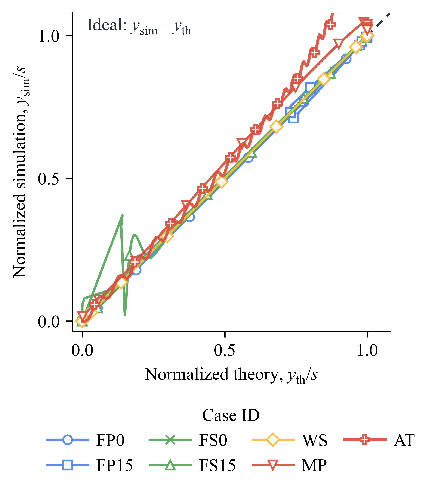
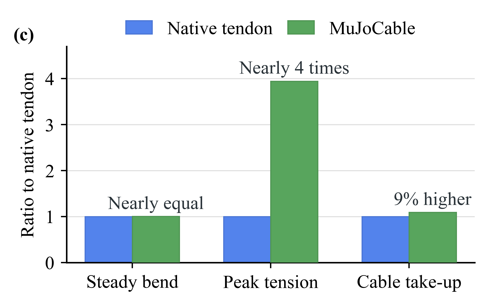
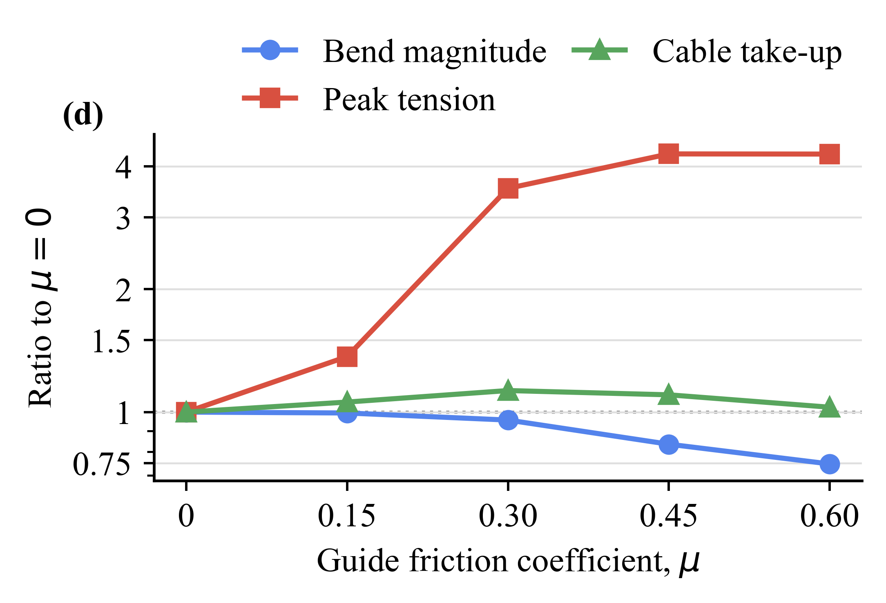

# MuJoCable Examples

[中文](README_zh.md) | [Paper cases](paper/README.md) | [Small standalone demos](../docs/DEMO_CATALOG.md)

The [paper examples](paper/) collect the models, data, figures and raw/annotated
videos used to investigate cable transmission: pulley mechanics, rolling
contacts, native-tendon comparisons, guide friction and underactuated fingers.

[Irregular-surface showcases](showcase/) add elliptic/cam/rounded-rectangular
pulleys and multi-letter surface routing, with separate manual/automatic commands.

Start with [paper/README.md](paper/README.md) for the experiment map and commands.
Historical paper results remain separate from new-plugin reproductions. Full-hand
development and unsuccessful grasp tuning are not presented as validated paper
experiments here.

