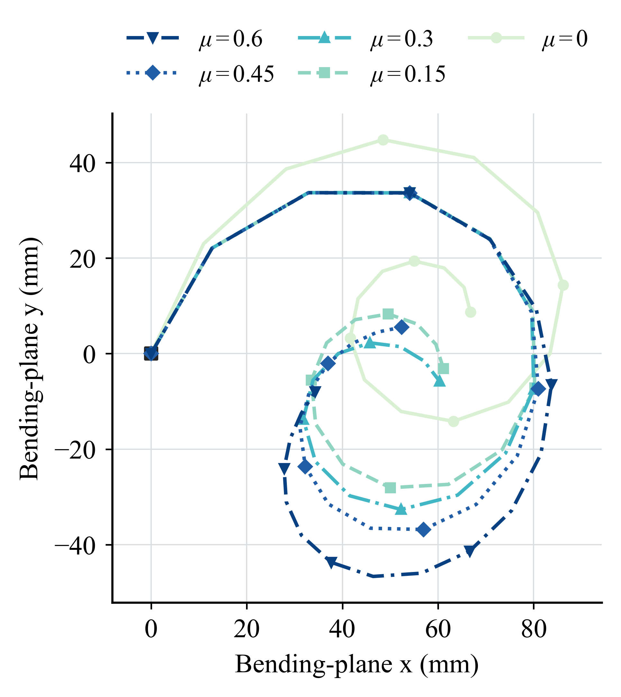

# Paper Experiments

[中文说明](README_zh.md) | [Paper](https://arxiv.org/abs/2609.09612) | [Project](https://mujocable.github.io/)

These are frozen simulation-side cases supporting **MuJoCable: Reduced-Order
Surface-Routed Cable Transmission for Tendon-Driven Robots**. CSVs, plots and
videos are archived evidence, not newly synthesized data. Their historical
plugin hash is recorded in [PROVENANCE.json](PROVENANCE.json). Run outputs from
the current plugin go to `outputs/paper_latest/` and never overwrite this archive.

[Fresh numerical reproductions](latest_plugin/README.md) are also provided,
with library/source hashes, per-case CSVs, plots and the full calibrated-model
bending cycle. The archived videos remain labeled as historical recordings.

## Experiment Map

| Case | Question and evidence | Folder |
|---|---|---|
| Fixed pulley, mu=0/0.15 | Equal tension, 1:1 lift and regularized Capstan ratio | [Result 1.1](result_1_1/) |
| Free inertial sheave | Tension difference produces passive pulley rotation | [Result 1.1b](result_1_1_b/) |
| Winch and sheave | Circumferential travel and radius ratio; explicit ideal equality baseline | [Result 1.1c](result_1_1_c/) |
| Moving pulley | Two supporting cable spans, approximately 2:1 take-up/lift | [Result 1.2](result_1_2/) |
| Atwood with landing | Inertial motion before impact; contact and slack afterwards | [Result 1.3](result_1_3/) |
| Faive rolling contact | Prescribed virtual hinges versus moving-mesh cable routing | [Result 2.1](result_2_1/) |
| Matched SpiRobs | Same joint elasticity, native tendon/muscle versus cable plugin | [Result 2.2](result_2_2/) |
| Guide-friction sweep | mu=0, 0.15, 0.30, 0.45, 0.60: take-up, load and individual joint angles | [Result 2.3](result_2_3/) |
| Single finger | One antagonistic input pair, four passive routes and friction sensitivity | [Demo 42 supplement](result_2_2/demo42_single_finger/) |
| Calibrated SpiRobs | Right/neutral/left/neutral cycle and 20-mm-drum servo trajectories | [Result 3.2 simulation](result_3_2/) |

The Result 3.1 model is retained in [result_3_1/models](result_3_1/models/).
Its duplicated analysis and videos are stored once in the Demo 42 supplement.
Raw hardware trial records are **not included**. A simulation snapshot or a
video comparison is not a calibrated repeated-trial hardware dataset.

## Browse Results and Videos



- Rolling joint: [raw](result_2_1/videos/result_2_1_mujocable_50deg_raw.mp4), [annotated](result_2_1/videos/result_2_1_mujocable_50deg_annotated.mp4).
- SpiRobs plugin: [raw](result_2_2/videos/result_2_2_mujocable_raw.mp4), [annotated](result_2_2/videos/result_2_2_mujocable_annotated.mp4).
- Native baseline: [raw](result_2_2/videos/result_2_2_native_tendon_raw.mp4), [annotated](result_2_2/videos/result_2_2_native_tendon_annotated.mp4).
- Finger, bending-plane view: [raw](result_2_2/demo42_single_finger/videos/result_2_2c_demo42_bending_plane_raw.mp4), [annotated](result_2_2/demo42_single_finger/videos/result_2_2c_demo42_bending_plane_annotated.mp4).
- Full inventory: [VIDEO_INVENTORY.csv](VIDEO_INVENTORY.csv).

GitHub may download an MP4 instead of playing it inline. The project page has
embedded demonstrations. Filenames preserve result identifiers from the paper
workspace, including earlier illustrative videos; use the `50deg` recordings
for the final Result 2.1 comparison, not the earlier low-amplitude Demo 25 clip.

## Install and Open

Build the current plugin using the repository's [source instructions](../../README.md#build-from-source), then:

```bash
python -m pip install -r examples/paper/requirements.txt
python examples/paper/run.py list

# macOS: run.py selects mjpython for the viewer; Linux selects Python.
python examples/paper/run.py view rolling_mesh --show-cable-state
python examples/paper/run.py view finger --show-cable-state
python examples/paper/run.py view spirobs --show-cable-state
python examples/paper/run.py view moving_pulley
```

View mode starts with automatic control disabled. Use the standard viewer's
Control panel. Commands act on cables except for explicitly named native or
ideal-joint baselines and the physical winch motor. SpiRobs has an initial
slack reserve; moving a slider by a few millimeters is not necessarily enough
to tension the cable. Use the reproduction controller below for the paper
trajectory rather than treating a slider value as a prescribed bend angle.

`--plugin` or `CABLE_PLUGIN_LIBRARY` can select another build. By default the
library is `build/plugin/libcable_unilateral.dylib` on macOS or `.so` on Linux.

## Reproduce With the Current Plugin

The Python wrapper copies model inputs to a separate output folder, retains
the archived controllers, and records the library and core-source hashes.
It does not copy the old output data into the new run.

```bash
# Seven pulley cases: theory, fresh CSV/JSON and publication-style plots.
python examples/paper/run.py result1 --skip-videos

# One pulley case; omitted --skip-videos renders raw/annotated video.
python examples/paper/run.py result1 --case result_1_1_mu_0p15 \
  --output outputs/paper_fixed_pulley

# Rolling contact, matched native baseline, and five friction conditions.
python examples/paper/run.py result2 --skip-videos

# Runtime measurement, independent of archived performance values.
python examples/paper/run.py benchmark --repeats 7 --duration 6

# Calibrated right/neutral/left/neutral cycle and servo CSV (20-mm drum).
python examples/paper/run.py cycle --duration 24 --guide-friction-mu 0.015 \
  --output outputs/paper_cycle

# Load/short-step all frozen models and optionally check every video.
python examples/paper/run.py audit --check-videos \
  --report outputs/paper_latest/model_audit.json
```

Install FFmpeg/ffprobe separately for video encoding and video checks. Rendering
also requires an available OpenGL context. Times New Roman is used when
installed; otherwise plots use a serif fallback. No proprietary font is bundled.

## Interpretation and Limits

- The winch example imposes an equality to define an **ideal** radius-ratio
  baseline. It is not evidence that friction alone enforces no slip.
- The moving-pulley case permits sliding. A 2:1 travel ratio does not imply a
  particular pulley-angle ratio.
- The Atwood closed-form reference ends at impact; post-impact oscillation
  and slack cannot be judged against the pre-impact equation.
- The 50-degree Faive snapshot isolates active cables. It does not establish
  validity of the earlier full passive-ligament network at every pose.
- Guide friction is a sustained-sliding/regularized model, not an exact
  static-stick solver. Parameter scans are sensitivity studies unless
  experimentally identified.
- Historical plots and video summaries may contain limits, saturation or
  occasional route failures. They are retained transparently, not silently
  edited into successful validation. Inspect per-case JSON and the
  [theory report](RESULT1_THEORY_AND_RESULTS_ZH.md).
- The compiled plugin's current optimizations do not add topology switching,
  rope mass or general free-cable collision.

See [ASSET_SOURCES.md](ASSET_SOURCES.md) for model provenance and permissions.
Please cite the [paper](https://arxiv.org/abs/2609.09612); the repository README
contains the complete citation.
