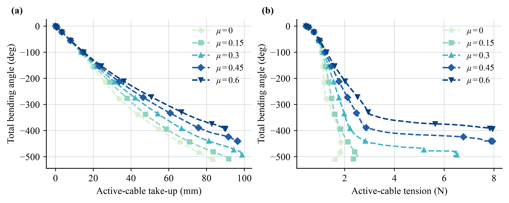

# Current-Plugin Reproduction, 2026-11-04

These numeric runs use the optimized plugin from main commit
`68c555951ec1f5ca222827876f4a37909fe18c87`. Library and source hashes are in
[RUN_MANIFEST.json](RUN_MANIFEST.json) and each `*_reproduction.json`.
The historical videos elsewhere in `examples/paper` were **not** re-rendered.

## Results

| Check | Fresh result | Interpretation |
|---|---:|---|
| Fixed pulley, mu=0 | Load tension 1.962 N; lift RMSE 0.161 mm | Consistent with the 0.2-kg payload and 1:1 travel. |
| Fixed pulley, mu=0.15 | Peak reference ratio 1.3674; measured 1.3614 | About 0.45% difference, for the regularized sliding model. |
| Free sheave, mu=0.15 | Peak 0.605 rad/s; torque RMSE 4.09e-5 N m | Passive rotation driven by tension difference. |
| Ideal winch/sheave baseline | Rim-travel RMSE 0.000473 mm | Equality-enforced ideal ratio, not an independently emerging no-slip result. |
| Moving pulley | Load lift 10.185 mm for 20-mm take-up | Approximately 2:1 travel; sliding remains allowed. |
| Atwood landing | Landing-time error -9.38% | A visible limit of the ideal pre-impact model, not a perfect match. |
| Faive PIP | Virtual hinge 49.994 deg; cable 52.481 deg | Different input/transmission models. |
| Matched SpiRobs, mu=0.15 | Plugin steady bend -522.970 deg; native -521.833 deg | Similar shape can coexist with different force states. |
| Calibrated-model cycle | Right -524.052 deg; left 523.770 deg; final error 0.406 deg | Full 24-s right/neutral/left/neutral cycle. |
| Two taut cables | Both sampled minima above 0.421 N | Both cables stayed taut at the recorded samples. |

All seven Result 1 cases have maximum reported route status 0 and no tension
saturation. The Faive and five SpiRobs friction conditions also report maximum
route status 0 in the recorded results. The Faive `contact_fraction=0.9992`
is the **rigid-body contact fraction**, not a route-validity fraction.

### Friction Sweep

| Guide mu | Steady bend (deg) | Peak source tension (N) | Maximum take-up (mm) |
|---:|---:|---:|---:|
| 0.00 | -525.597 | 1.856 | 87.590 |
| 0.15 | -522.970 | 2.538 | 92.694 |
| 0.30 | -502.496 | 6.553 | 98.907 |
| 0.45 | -438.513 | 7.959 | 96.553 |
| 0.60 | -392.338 | 7.951 | 90.041 |

The cycle's neighboring links do not all remain in bending-side contact at
every sample. Material/beam-derived flexibility is not a new hardware
parameter-identification result. Native and plugin force laws differ, so
force ratios alone do not establish which predicts hardware better. These
deterministic runs have no repeated-trial confidence intervals.

## Data

- [Result 1 summary](result1/result_1_summary.csv), with per-case data/figures.
- [Result 2 summary](result2/result_2_summary.csv), with joint-angle time
  series and route/load records in the per-case folders.
- [Full bending cycle](cycle/demo49_tpu95hf/): servo trajectory, cable lengths
  and plots for a 20-mm-diameter drum.
- [Model/media audit](model_media_audit.json): 23 loaded/short-stepped models
  and 38 readable videos. This is not full-motion validation.

Timing collected with these runs is diagnostic: other jobs were running,
so it is **not** a new isolated runtime benchmark.
