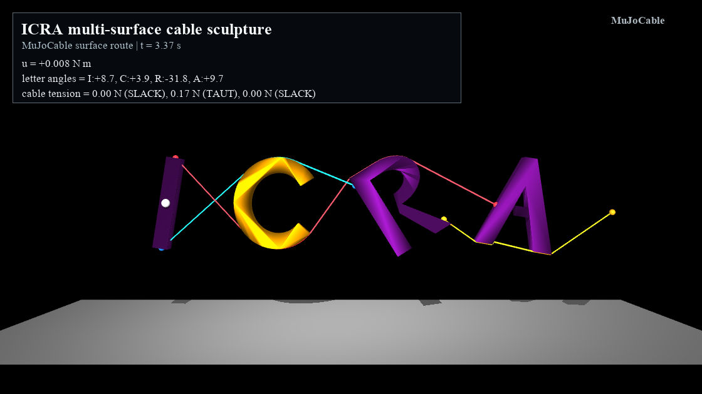

# Irregular-Surface Showcases

Qualitative demonstrations, separate from the paper's quantitative cases.
The models and videos are archived project-generated material; the ICRA
letter sculpture is illustrative and is not an official conference asset or
an endorsement. The code and generated geometry use the repository license.

The current-plugin headless controls were re-run on 2026-11-04; all four
cases remained finite with maximum route status 0. See
[latest_validation.json](latest_validation.json). Archived videos were not
re-rendered during that numerical check.

| Model | Preview | Videos |
|---|---|---|
| Elliptic pulley | [poster](videos/irregular_pulley_ellipse_poster.png) | [raw](videos/irregular_pulley_ellipse_raw.mp4), [annotated](videos/irregular_pulley_ellipse_annotated.mp4) |
| Asymmetric cam | [poster](videos/irregular_pulley_cam_poster.png) | [raw](videos/irregular_pulley_cam_raw.mp4), [annotated](videos/irregular_pulley_cam_annotated.mp4) |
| Rounded rectangle | [poster](videos/irregular_pulley_box_poster.png) | [raw](videos/irregular_pulley_box_raw.mp4), [annotated](videos/irregular_pulley_box_annotated.mp4) |
| ICRA surface cables | [poster](videos/icra_surface_cables_poster.png) | [raw](videos/icra_surface_cables_raw.mp4), [annotated](videos/icra_surface_cables_annotated.mp4) |



From the repository root, after building the current plugin:

```bash
# macOS; on Linux use python and a .so library.
PLUGIN=build/plugin/libcable_unilateral.dylib

# Manual Control-panel input; no automatic drive.
mjpython scripts/view_cpp_plugin_demo.py --plugin "$PLUGIN" \
  --model examples/showcase/models/icra_surface_cables.xml \
  --no-auto-control --show-cable-state --duration 120

# Automatically torque the I; other letters respond to cable forces.
mjpython scripts/view_cpp_plugin_demo.py --plugin "$PLUGIN" \
  --model examples/showcase/models/icra_surface_cables.xml \
  --auto-actuator I_drive --ctrl-final 0.008 --duration 120

# Ellipse: replace ellipse with cam or box for the other two shapes.
mjpython scripts/view_cpp_plugin_demo.py --plugin "$PLUGIN" \
  --model examples/showcase/models/irregular_pulley_ellipse.xml \
  --auto-actuator pulley_drive --ctrl-final 0.0015 --duration 120

# Remove auto control on the irregular pulley as above for manual input.
# Fresh raw/annotated videos, outside the archived videos folder:
python examples/showcase/scripts/record_showcases.py --plugin "$PLUGIN" \
  --output outputs/showcase_latest
```

The letter meshes are 24 mm thick, extruded along local y. Endpoints and
initialization hints lie at y=0, with a guided mid-thickness corridor. The
red cable wraps C and R, blue wraps C, and yellow wraps A. Only the I motor
is actuated. Other letters have passive hinges; this is not a freely floating
four-body system.

The irregular pulleys use their actual rounded mesh contours, not hidden
cylinder replacements. The rectangle is rounded to avoid the nonunique
tangent at a mathematically sharp corner. A slack massless cable has zero
tension but does not acquire a gravity-sagged rope shape or automatically
change its initialized routing topology after landing.

FFmpeg and a working OpenGL context are needed for recording. The generated
mesh/texture source is retained in `scripts/generate_showcase_assets.py`;
regenerating models can overwrite manual site adjustments, so use it only
in a separate copy when tuning routes.
